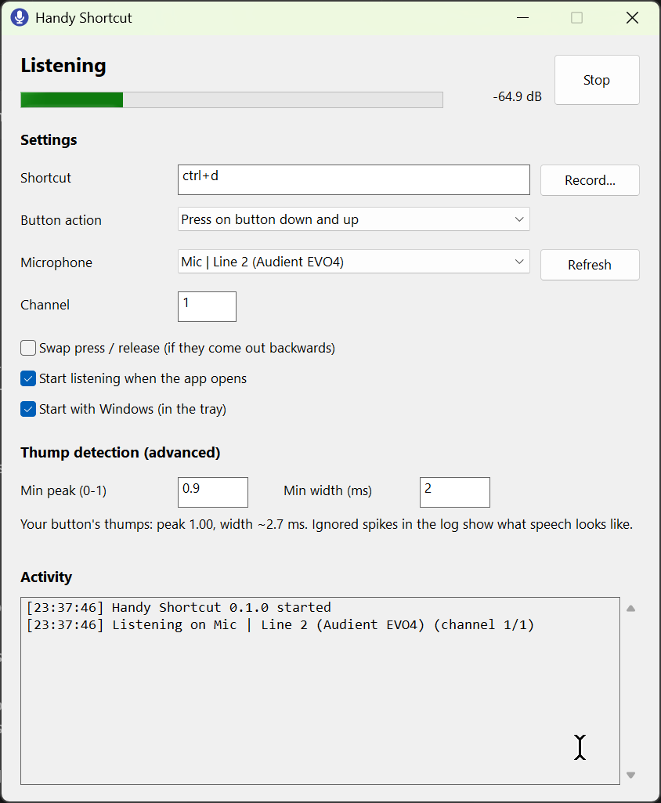

# Handy Shortcut

Makes the hold-to-talk button on the **teenage engineering handy microphone**
trigger a keyboard shortcut on Windows, such as the Transcribe Shortcut in the
[Handy](https://handy.computer) speech-to-text app. The button sends nothing
to the computer, so the app listens for the click it makes in the audio.

## Use

Download the exe from [Releases](../../releases) and run it. It sits in the
tray; closing the window hides it there.

- **Button action:** hold the shortcut while the button is down, or press it
  once on button down and up (for toggle mode), or on button down only.
- **Start with Windows** starts it in the tray at login.
- If presses come out as releases, tick **Swap press / release**. If clicks
  show up as "ignored" in the Activity log, lower **Min peak** or **Min width**.

Tested with the handy microphone through an Audient EVO4 on Windows 11.
Settings and the log are in `%APPDATA%\Handy Shortcut\`.

## Build

Needs [Rust](https://rustup.rs) and the Visual Studio C++ Build Tools.
`.\build.ps1` builds `dist\Handy Shortcut.exe`; add `-Test` to run the tests.
